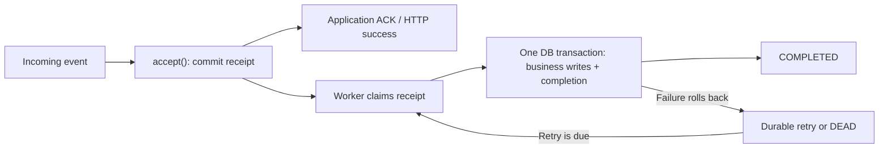

# @nestarc/inbox

**Turn repeated deliveries into one committed database outcome per retained message identity.**

A transactional inbox for **NestJS, Prisma, and PostgreSQL**. Store an incoming event durably, acknowledge its delivery, then commit your business writes and inbox completion in one database transaction. Retries and crash recovery use the same durable record.

**Version `0.2.0` · SQL schema v2.** APIs and schema may change before 1.0; review the [changelog](CHANGELOG.md) and migration steps when upgrading.

[Install](#1-install-the-package) · [Try it locally](#try-it-locally) · [Integrate with NestJS](#integrate-with-nestjs) · [Reliability evidence](#reliability-evidence) · [Performance](#performance) · [Usage guide](docs/usage.md) · [Testing helpers](docs/testing.md)

## Why use Inbox?

- **Handle redelivery without repeating committed work.** A stable event identity deduplicates webhook retries and broker redeliveries, including concurrent arrivals.
- **Keep business state and processing status consistent.** Writes through `context.tx`, optional outbox events, and inbox completion commit or roll back together.
- **Recover after a worker exits.** PostgreSQL leases, claim tokens, and durable retry timing allow another worker to resume eligible work.
- **Make failures operable.** Inspect backlog and DEAD records, requeue failures after a fix, or explicitly replay completed messages with an audit trail.

Inbox uses your application's existing Prisma client and PostgreSQL database. The core needs no additional cache or broker service. Your application connects to the transport and decides when to ACK, delete a delivery, commit an offset, or return HTTP success.

## How it works



The identity is **scope + source + consumer + message ID**. Repeating that identity with the same content returns `duplicate`; different content raises `InboxConflictError`. A duplicate receipt keeps its current processing state.

**Acceptance means stored, not processed.** Handler calls may repeat after failures. The guarantee covers successfully committed writes in the supplied transaction while the receipt is retained. External HTTP calls, email, another database, and different event IDs for the same business action need their own idempotency or outbox contract. Message ordering is not guaranteed.

## Is it a fit?

| Your application needs                                               | What to plan for                                                                                                                                  |
| -------------------------------------------------------------------- | ------------------------------------------------------------------------------------------------------------------------------------------------- |
| Reliable webhook or broker consumers on NestJS + Prisma + PostgreSQL | Authenticate the sender, derive the tenant scope, and preserve the producer's event ID across redeliveries.                                       |
| Atomic database effects and processing completion                    | Perform every handler write through `context.tx`. Keep external network work outside this transaction.                                            |
| Multiple workers and recoverable failures                            | Size the database pool for handler transactions, acceptance, and lease heartbeats; monitor backlog age and DEAD counts.                           |
| Tenant-scoped processing and administration                          | Scope is part of identity. Database RLS requires application policies and a restricted role; an optional tenancy adapter helps apply the context. |
| A package to evaluate before rollout                                 | This is a pre-1.0 release. Validate sustained production load, database failover, and operational recovery for your deployment.                   |

### Compatibility

| Component        | Current contract and validation                                                                                              |
| ---------------- | ---------------------------------------------------------------------------------------------------------------------------- |
| NestJS           | `^11.2.8`; tested with 11.2.8                                                                                                |
| Prisma client    | `^7.10.1`; tested with 7.10.1 and its PostgreSQL driver adapter                                                              |
| PostgreSQL       | Integration and crash-recovery tests exercised 16 and 18                                                                     |
| Node.js          | Package engine: `>=22.12.0`. Use **22.23.4+ or 24.22.1+** to match the full validation checks and optional tenancy examples. |
| Modules          | CommonJS and dynamic ESM imports checked from an installed tarball                                                           |
| Optional tenancy | `@nestarc/tenancy ^0.16.2`; not required for the core package                                                                |

The package also declares Nest core, `reflect-metadata`, and `rxjs` peers. See [package.json](package.json) for exact ranges and [validation results](docs/validation.md) for the combinations actually exercised.

## Try it locally

With a supported Node.js version and Docker running, execute these commands **from this repository checkout**:

```sh
npm ci
npm run test:package
```

This builds a tarball, installs it in a separate consumer, starts a disposable PostgreSQL database, and checks types, imports, SQL assets, deduplication, rollback, replay, and scoped administration. A successful run ends with:

```text
Installed @nestarc/inbox 0.2.0 tarball verification passed.
```

The runner ignores an existing application `DATABASE_URL`, uses a random local port, and removes its container afterward. The first run may download dependencies and a database image. Docker or database failures fail the check rather than skipping it.

To explore the integrations with temporary databases and brokers:

```sh
npm run test:examples
npm run test:operations
npm run test:operations:database
# Install example dependencies once for the RabbitMQ recovery fixture:
npm install --prefix examples --no-audit --no-fund
npm run test:broker-recovery
```

That runs all eight [examples](examples/README.md), including an outbox → inbox → business write → outbox chain. You can also follow the examples guide to run one integration at a time.

## Reliability evidence

The implementation is checked against real databases and installed package artifacts, alongside unit tests.

| Failure or integration boundary | Evidence                                                                                                                                                          |
| ------------------------------- | ----------------------------------------------------------------------------------------------------------------------------------------------------------------- |
| Concurrent redelivery           | 100 concurrent copies converge on one receipt; changed content is rejected.                                                                                       |
| Business-write failure          | Handler writes, optional outbox writes, and completion roll back together.                                                                                        |
| Process termination             | Child processes are killed with `SIGKILL` after acceptance, after a claim, and after completion update but before commit; recovery is checked against PostgreSQL. |
| Stale workers                   | A newer claim token prevents the previous worker from committing business writes or overwriting processing state.                                                 |
| Replay and tenancy              | Concurrent replay requests, v1→v2 migration, restricted-role RLS, cross-tenant rejection, and connection context cleanup are checked.                             |
| Package installation            | Separate consumers verify generated Prisma types, CommonJS/ESM imports, SQL exports, and core use without the optional tenancy package.                           |

Recorded checks for the local Preview.1 baseline include **85 unit tests**, **38 database/crash tests on each of PostgreSQL 16 and 18**, **41 release checks on Node 22 and 24**, and **eight runnable integrations**. GitHub-hosted [CI run 40684612217](https://github.com/nestarc/inbox/actions/runs/40684612217) passed all four Node/PostgreSQL combinations and the examples at commit `664b4fc`. Version 0.1.0 promotes that runtime implementation and schema; the promotion changes version metadata and documentation. Counts describe the recorded runs, not a guarantee of every runtime or failure scenario. [Read the test-to-contract mapping and remaining validation](docs/validation.md).

The 0.2.0 follow-up adds **20 testing-helper unit checks**, **three PostgreSQL helper cases**, and actual TCP faults, pool saturation, SIGTERM, PostgreSQL standby promotion, bounded tablespace exhaustion, and RabbitMQ restart/retry/DLQ recovery checks. The [current validation record](docs/validation.md) distinguishes each tested condition from deployment-specific guarantees. Existing 0.1.0 installations keep schema v2 without a migration.

A lost commit response is tested by error injection after a real commit. Separate operational tests exercise actual connection loss and blackholes, standby promotion after confirmed WAL replay, business-tablespace ENOSPC, and bounded pool pressure. Automatic failover routing, unreplicated commit loss, WAL-volume exhaustion, and application-specific soak tests remain deployment concerns.

## Performance

**1,400–2,468 `accept()` calls/second across three local runs**, with the expected business-effect counts and zero observed acceptance or worker errors. These are measurements of **Preview.1 / schema v2**, taken on 28 October 2026. Version 0.1.0 uses the same runtime implementation and schema; the recorded benchmark version remains Preview.1.

| Scenario                                 | Receive calls/second |   Receive p95 |
| ---------------------------------------- | -------------------: | ------------: |
| Fresh table, unique events               |          1,400–2,124 | 5.29–11.61 ms |
| 10,000 retained receipts, unique events  |          2,331–2,468 |  4.60–5.28 ms |
| 10,000 retained receipts, 90% duplicates |          1,813–2,062 |  5.29–6.62 ms |

Each range includes all three runs. Across **4,500 calls**, the benchmark verified **3,150 committed business effects** and **1,350 duplicate receipts**.

Environment: Apple M1 Pro, Node 24.22.1, PostgreSQL 16.15 in Docker on **tmpfs**, loopback networking, 265-byte payloads, 500 calls per scenario, receive concurrency 8 and worker concurrency 4. Receipt acceptance and worker draining run **separately**. These rates do not represent end-to-end event latency, sustained handler throughput, or a production SLA. Fixed scenario order may warm later cases; the results do not imply that retaining more receipts makes processing faster.

The implementation uses partial indexes for due work and expired leases, `SKIP LOCKED` claims, and bounded worker concurrency. Tune concurrency and pool capacity against your own handler and database. Default polling adds scheduling delay beyond the receive latency above.

[All measurements, raw JSON, and methodology](docs/benchmarks/2026-10-28-preview1-local.md) are available to inspect. Reproduce the benchmark against a disposable database:

```sh
npm run benchmark
```

For simultaneous ingress and processing on a disk-backed fixture, run `npm run benchmark:sustained`. The [sustained load report](docs/benchmarks/2026-10-28-sustained-local.md) records overload recovery, pool waiting, hot/cold tenant latency, and payload retention. It is a separate workload from the short acceptance benchmark above.

## Integrate with NestJS

The following steps target an **existing NestJS 11 application with Prisma 7**, using the versions in the compatibility table above. Your application owns its Prisma client, database migrations, transport credentials, and shutdown lifecycle.

### 1. Install the package

In your application directory, install Inbox and the adapter matching your Prisma client:

```sh
npm install @nestarc/inbox@0.2.0
npm install @prisma/adapter-pg@7.10.1
```

For a local source build, run `npm ci` and `npm pack` in this repository checkout. `prepack` builds the library. Install the resulting tarball in your application instead:

```sh
npm install /absolute/path/to/inbox/nestarc-inbox-0.2.0.tgz
```

### 2. Apply the schema

Locate the packaged installation SQL:

```sh
node -p "require.resolve('@nestarc/inbox/sql/create-inbox-table.sql')"
```

Add that SQL to your application's migration process and apply it **before starting Inbox**. It creates the inbox tables and indexes. Runtime checks the schema; it never creates or upgrades tables. Keep the SQL in migration history and ensure generated migrations or schema synchronization do not drop the Inbox tables.

For the example below, add this application model, generate your Prisma client, and apply its migration too:

```prisma
model OrderProjection {
  tenantId String @map("tenant_id")
  orderId  String @map("order_id")

  @@id([tenantId, orderId])
  @@map("order_projections")
}
```

The composite key also protects the application's business identity if different event IDs refer to the same order. Such a conflict is a handler failure to resolve, not a silently successful Inbox duplicate.

**Already using schema v1 from a local development build?** Follow the [schema v2 migration steps](CHANGELOG.md#upgrade-action-schema-version-2) instead of applying the fresh-install SQL.

### 3. Register a handler and ingress service

In `src/orders.module.ts`, adjust the generated-client import to your Prisma output path. The client below uses your application's `DATABASE_URL`; reuse your existing client if you already provide one.

```ts
import "reflect-metadata";
import { Injectable, Module } from "@nestjs/common";
import { PrismaPg } from "@prisma/adapter-pg";
import {
  InboxModule,
  InboxPermanentError,
  InboxService,
  type InboxHandler,
} from "@nestarc/inbox";
import { PrismaClient, type Prisma } from "./generated/prisma/client";

export const prisma = new PrismaClient({
  adapter: new PrismaPg({ connectionString: process.env.DATABASE_URL }),
});

const orderCreated: InboxHandler<
  { orderId: string },
  Prisma.TransactionClient
> = {
  consumer: "orders.projection.v1",
  eventType: "order.created",
  schemaVersion: 1,
  validate(payload) {
    return (
      !!payload &&
      typeof payload === "object" &&
      !Array.isArray(payload) &&
      typeof payload.orderId === "string" &&
      payload.orderId.length > 0
    );
  },
  async handle(payload, context) {
    if (context.scope.kind !== "tenant") throw new InboxPermanentError();
    await context.tx.orderProjection.create({
      data: { tenantId: context.scope.id, orderId: payload.orderId },
    });
  },
};

@Injectable()
export class OrdersIngress {
  constructor(private readonly inbox: InboxService) {}

  receive(verifiedTenantId: string, event: { id: string; orderId: string }) {
    return this.inbox.accept({
      scope: { kind: "tenant", id: verifiedTenantId },
      source: "orders-service",
      consumer: "orders.projection.v1",
      messageId: event.id,
      eventType: "order.created",
      schemaVersion: 1,
      payload: { orderId: event.orderId },
    });
  }
}

@Module({
  imports: [
    InboxModule.forRoot({
      prisma,
      handlers: [orderCreated],
      worker: { enabled: true },
    }),
  ],
  providers: [OrdersIngress],
  exports: [OrdersIngress],
})
export class OrdersModule {}
```

Import `OrdersModule` into your application module and inject `OrdersIngress` into your transport consumer. Use a tenant ID derived from authenticated routing or credentials. Reuse the same `event.id` on redelivery.

### 4. Acknowledge after acceptance

For a RabbitMQ consumer, the application boundary looks like this:

```ts
await ordersIngress.receive(verifiedTenantId, event);
channel.ack(message);
```

Both `accepted` and `duplicate` permit acknowledgment: Inbox now owns processing retries. If acceptance throws or its commit outcome is uncertain, do not ACK; redeliver the same identity. Authentication errors, malformed input, and identity conflicts need a rejection or dead-letter policy. See the [transport examples](examples/README.md) for complete handling.

The worker is opt-in and polls every 1,000 ms by default; acceptance does not wait for the handler. Check `InboxAdminService.forTenant(id).get(receipt.id)` or `stats()` for processing progress. Close the Nest application before disconnecting its Prisma client; Inbox does not own that client. For dependency-injected clients and services, use [`forRootAsync`](docs/usage.md#register-a-consumer).

## Recovery and integrations

Failures retry with persisted exponential backoff and jitter. Permanent errors or exhausted attempts become **DEAD**, where operators can inspect and requeue them with an expected version. An explicit replay creates a **new receipt** for a completed message and preserves the original; it deliberately permits another business execution.

Completed payload cleanup preserves the deduplication fingerprint and replay lineage. Deleting receipts or restoring an older database backup reduces the deduplication history. [Retries, retention, administration, and replay](docs/usage.md)

| Example                         | What it demonstrates                                                       |
| ------------------------------- | -------------------------------------------------------------------------- |
| Outbox                          | Business writes and a follow-up outbox event in the handler transaction    |
| Signed webhook                  | Signature validation before tenant mapping and durable acceptance          |
| RabbitMQ                        | Acceptance before ACK, bounded transport retries, and dead-letter handling |
| Kafka / SQS-compatible / BullMQ | Acceptance before offset commit, message deletion, or processor completion |
| Tenancy                         | Optional `createInboxTenancyContext()` with real PostgreSQL RLS            |
| HTTP idempotency                | Inbox deduplication surviving expiry of an HTTP response cache             |

The Kafka fixture uses Redpanda; the SQS fixture uses ElasticMQ. They validate the examples' protocol composition, not every Kafka deployment or production AWS configuration. [Run and inspect the examples](examples/README.md).

## Development and releases

```sh
npm ci
npm run build
npm run typecheck
npm run format:check
npm test
npm run test:release
npm run test:integration
npm run test:package
npm run test:examples
npm run test:operations
npm run test:operations:database
# Install example dependencies once for the RabbitMQ recovery fixture:
npm install --prefix examples --no-audit --no-fund
npm run test:broker-recovery
```

Database checks require Docker. Set `INBOX_TEST_POSTGRES_IMAGE=postgres:18-alpine` to select PostgreSQL 18 for the general fixture; its default is 16. The dedicated `test:operations:database` primary/standby and ENOSPC suite is pinned to PostgreSQL 16.

CI and releases share a Node 22/24 × PostgreSQL 16/18 validation workflow. A GitHub Release is configured to publish the exact tested tarball through npm OIDC: prereleases to `next`, release versions such as 0.2.0 to `latest`. A separate Node 24/PostgreSQL 16 gate checks operational recovery. Manual runs only validate and dry-run. [Release setup and publishing procedure](docs/releasing.md)

[Changelog](CHANGELOG.md) · [Full usage guide](docs/usage.md) · [Validation record](docs/validation.md) · [Architecture decision](docs/adr/0001-durable-inbox.md) · [Roadmap](docs/implementation-roadmap.md)

MIT licensed.
