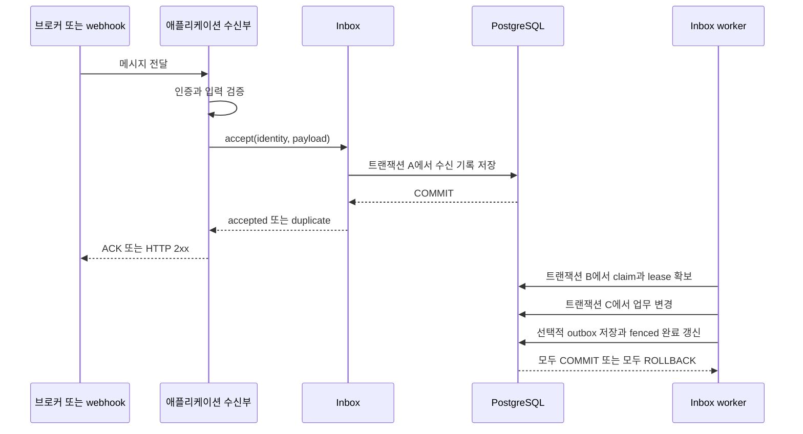
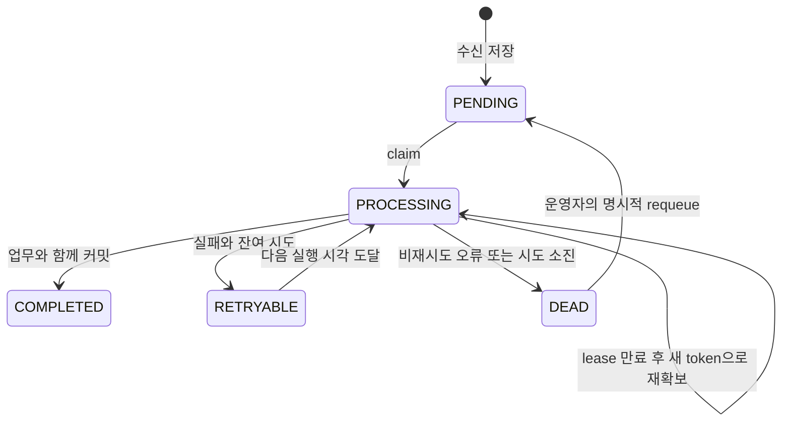

# @nestarc/inbox 패키지 기획

작성일: 2026년 10월 27일 · 상태: MVP 구현 기준 · 첫 공개 목표: `0.1.0 Preview`

현재 구현과 실제 실행한 검증 범위는 [사용법](usage.md)과 [검증 기록](validation.md)을 따른다. 이 문서는 초기 제품 결정과 후속 개발 범위를 보존한다.

2026-10-28 Preview.1에서는 초기 후속 항목 중 완료 메시지의 별도 receipt replay, tenancy adapter와 실제 RLS 검증, Kafka·SQS 호환·BullMQ 수신 예제, idempotency PostgreSQL 조합을 추가했다. JSON/hash·retry·취소 primitive는 private source workspace로 추출했다. 다른 저장소의 패키지를 이 workspace로 이전한 것은 아니며 lease/fencing SQL은 저장소 구현에 남긴다. 아래 초기 MVP의 제한은 이 변경 이력과 함께 읽는다.

`@nestarc/inbox`는 NestJS 애플리케이션이 받은 메시지를 PostgreSQL에 저장하고, 중복 수신과 장애 후 재시도를 관리하는 패키지다. 첫 버전은 Prisma를 사용하는 짧은 DB 업무 처리에 집중한다. **업무 변경, inbox 처리 완료, 선택적인 outbox 이벤트 저장을 같은 트랜잭션으로 커밋하는 것**이 핵심 가치다.

공개 패키지는 하나로 시작한다. 브로커에서 받은 메시지를 저장하는 `accept()`와 저장된 메시지를 처리하는 worker를 제공하고, 범용 작업 큐·워크플로·브로커 클라이언트는 기존 도구에 맡긴다.

## 리서치에서 채택한 방향

[원 리서치 대화](https://chatgpt.com/c/6ae098e4-d354-83ee-a184-f0801b1f80fa)의 「nestarc.dev 패키지 포트폴리오 유지·중단·신규 개발 검토 보고서」는 inbox를 신규 개발 최우선으로 추천한다. 보고서의 95점은 잠정 전략 점수다. 다운로드·외부 도입·유지보수 지표를 모두 확보한 시장 검증 결과로 해석하지 않는다.

| 리서치 제안 | 이번 기획에 반영할 결정 |
| --- | --- |
| 수신 이벤트의 영구 중복 제거와 재처리 | 메시지 저장부터 완료·실패 격리까지 inbox가 관리 |
| outbox와 연결되는 신뢰성 계층 | 소비자 DB 트랜잭션 안에서 `outbox.emit(tx, ...)` 사용 |
| jobs의 범용 큐 기능 확대를 줄임 | cron, DAG, 우선순위 큐, 브로커 운영 기능은 제외 |
| lease와 fencing으로 오래된 작업자의 변경 차단 | 소유권을 잃은 worker의 완료 갱신과 업무 커밋을 차단 |
| reliability-core는 내부에서 검증 | 초기에는 `src/internal`로 구현하고 별도 공개 패키지 보류 |

이 방향에는 기존 코드의 근거도 있다. outbox의 [quick-start](https://github.com/nestarc/outbox/blob/main/examples/quick-start/README.md)는 소비자 처리 기록과 DB 변경을 하나의 트랜잭션으로 저장하는 코드를 애플리케이션이 작성하게 한다. idempotency의 [adoption recipes](https://github.com/nestarc/idempotency/blob/main/docs/adoption-recipes.md)도 이벤트 수신 기록, 업무 중복 방지, 순서 처리를 구별한다. inbox는 이 중 반복되는 수신 기록과 처리 복구를 패키지화한다.

## 목표 사용자와 해결할 문제

첫 사용자는 NestJS·Prisma·PostgreSQL을 이미 사용하고, 외부 이벤트 또는 outbox 이벤트로 업무 데이터를 변경하는 개발자다. 처음 검증할 시나리오는 주문 이벤트를 받아 주문 projection을 갱신하고 후속 이벤트를 만드는 서비스다. 두 번째는 서명 검증을 마친 webhook을 저장한 뒤 비동기로 반영하는 서비스다.

사용자는 다음 작업을 직접 구현하지 않아도 되어야 한다.

- 같은 메시지가 여러 인스턴스에 동시에 도착해도 수신 기록을 하나만 만든다.
- 수신 저장 후 프로세스가 종료되어도 메시지를 다시 처리한다.
- 실패한 업무 변경은 롤백하고, 재시도 횟수와 다음 실행 시각은 영구 저장한다.
- 반복 실패를 격리하고, 원인을 수정한 뒤 명시적으로 재처리한다.
- 처리 기록과 실제 업무 데이터가 서로 다른 결과로 커밋되는 일을 막는다.

**메시지 ID가 다른 두 이벤트가 동일한 주문을 생성하는 문제**는 업무 테이블의 unique constraint로 해결한다. 이벤트 도착 순서 역전은 업무 버전 검사 등으로 해결한다. inbox의 메시지 중복 제거가 이 두 문제까지 해결하지는 않는다.

## Nestarc 패키지 사이의 책임

| 패키지 | 소유하는 책임 | inbox와의 연결 |
| --- | --- | --- |
| `idempotency` | HTTP 요청 중복 검사와 응답 재생 | HTTP 경계에서 선택적으로 조합 |
| `inbox` | 수신 메시지 저장, 중복 제거, 처리 상태와 재시도 | 이번 개발 대상 |
| `outbox` | 업무 변경과 발신 이벤트 저장의 원자성, 발행 재시도 | inbox handler의 `tx`로 후속 이벤트 저장 |
| `webhook` | 외부 endpoint로 webhook 발신 | outbox 이후 외부 전달 경로 |
| `jobs` 또는 기존 큐 | 작업 전달·스케줄·브로커 실행 | inbox에 메시지를 전달하는 기존 경로 |
| `tenancy` | tenant context와 데이터 접근 격리 | 선택적 연동, 필수 의존성 제외 |

연결 근거: [outbox](https://nestarc.dev/packages/outbox/), [idempotency](https://nestarc.dev/packages/idempotency/), [jobs](https://github.com/nestarc/jobs/blob/main/README.md), [webhook](https://github.com/nestarc/webhook/blob/main/README.md).

## 첫 버전의 처리 방식

**영구 수신 후 비동기 처리 모드 하나를 제공한다.** 더 작은 대안인 caller transaction 기반 중복 검사만으로 시작하면 재시도와 실패 격리는 브로커에 남는다. 이번 기획은 리서치가 제안한 자체 재처리를 포함하므로 두 모드를 동시에 공개하지 않는다.



`accept()`는 자신이 연 트랜잭션의 커밋을 확인한 뒤에만 반환한다. 외부 transaction을 받는 overload는 첫 버전에 제공하지 않는다. ACK를 너무 일찍 보내는 실수를 줄이기 위해서다. `accepted`는 업무 처리 완료를 뜻하지 않는다.

| 상황 | 수신부의 처리 | 재시도 책임 |
| --- | --- | --- |
| 새 수신 기록 커밋 완료 | ACK 또는 2xx | inbox |
| 같은 identity와 fingerprint가 이미 저장됨 | 현재 상태와 함께 duplicate 반환, ACK 또는 2xx | inbox, DEAD는 운영자 조치 |
| DB 실패 또는 커밋 결과 불확실 | 성공 ACK 금지 | 원 발신자나 브로커 재전달 |
| 같은 identity에 다른 내용 | conflict로 거절, 원래 레코드 보존 | 애플리케이션의 명시적 오류·DLQ 정책 |
| 인증 실패, 잘못된 envelope, 크기 초과 | 저장 전 거절 | 애플리케이션의 오류·DLQ 정책 |

NestJS RabbitMQ의 수동 ACK 설정은 [공식 문서](https://docs.nestjs.com/microservices/rabbitmq#message-acknowledgement)를 따른다. 첫 runnable 브로커 예제는 RabbitMQ 하나로 제한한다. Kafka offset의 연속 커밋, SQS visibility, BullMQ 완료 처리는 후속 예제로 검증한 뒤 안내한다.

## MVP 범위

| 영역 | 0.1 Preview에 포함 | 이후 수요에 따라 검토 |
| --- | --- | --- |
| 저장소 | PostgreSQL과 Prisma, SQL migration, schema 검증 | 다른 ORM과 DB |
| 수신 | `accept`, 복합 identity, 내용 충돌 검사, JSON 크기 제한 | batch 수신 |
| worker | DB polling, 제한된 동시성, claim, lease 갱신, fencing | 고급 스케줄·공정성 정책 |
| 업무 처리 | 전달받은 `tx`에서 업무 변경과 완료를 원자적으로 커밋 | caller transaction 기반 동기 처리 모드 |
| 실패 | 영구 retry 일정, backoff와 jitter, 최대 시도, DEAD | 별도 quarantine UI |
| 운영 | 범위를 지정하는 조회, DEAD requeue, 통계, 종료 처리 | 대시보드와 HTTP 관리 controller |
| 조합 | outbox 연동 예제, tenant scope 계약 | tenancy 전용 편의 adapter |
| 관측 | 구조화된 로그와 hooks, 처리 지연·상태 수치 | 전용 metrics exporter |

외부 HTTP 호출, 이메일, 결제 실행의 exactly-once, strict FIFO, saga, workflow, cron, HMAC 검증, HTTP 응답 캐시, 브로커 SDK는 범위에 넣지 않는다. worker는 저장된 수신 메시지의 복구에 필요한 기능만 가진다.

## 처리 보장

다음은 구현과 장애 테스트가 만족해야 하는 제품 계약이다.

1. 같은 identity의 레코드는 DB unique constraint로 하나만 존재한다.
2. handler는 장애 때문에 여러 번 호출될 수 있다. **같은 레코드에 대해 업무 DB 변경과 완료 기록이 함께 성공하는 트랜잭션은 최대 한 번**이어야 한다.
3. 2번 보장은 handler의 모든 쓰기가 전달받은 동일 DB transaction을 사용하고, 완료 기록이 보존될 때 성립한다. 별도 Prisma client·별도 DB·외부 API 쓰기는 포함하지 않는다.
4. 오래된 worker의 완료 갱신이 거절되면 업무 변경과 outbox 쓰기도 전부 롤백한다.
5. 성공은 DB 커밋으로 결정한다. 로그·hook 실패가 성공 레코드를 실패로 되돌리지 않는다.
6. 반복 실패는 DEAD에 남는다. 유한한 재시도 정책이 모든 메시지의 최종 성공을 보장하지는 않는다.
7. 완료 기록을 삭제하면 과거 메시지를 다시 받아 처리할 수 있다. 보존 기간은 중복 제거의 보장 기간이다.

외부 부작용이 필요하면 handler는 같은 `tx`로 outbox를 기록한다. 그 뒤 외부 전달에는 수신 서비스의 durable idempotency key 등 별도 계약이 필요하다.

## 메시지 identity와 저장 모델

중복 제거 키는 `(scopeKind, scopeId, source, consumer, messageId)`다. 모든 열은 NOT NULL이다. tenant scope는 `scopeKind=tenant`와 tenant ID를 사용하고, 전역 작업은 `scopeKind=global, scopeId=''` 조합만 허용한다. 빈 tenant ID는 거절한다. SQL NULL의 unique 처리와 단순 문자열 이어붙이기에 의존하지 않는다. [PostgreSQL 제약 조건](https://www.postgresql.org/docs/current/ddl-constraints.html)

- `source`: 발행 서비스 또는 provider account까지 구분하는 안정적인 이름.
- `consumer`: 인스턴스 ID가 아닌 논리적 처리기 이름. 예: `orders.projection.v1`.
- `messageId`: 재전달에도 유지되는 발행자 ID. outbox 연동에서는 이벤트 record ID를 사용한다.
- `scope`: 인증된 수신 경로나 앱의 신뢰 가능한 매핑에서 결정한다. 검증하지 않은 payload의 tenant ID를 그대로 신뢰하지 않는다.

broker delivery tag, 시도 번호, 매번 생성한 UUID는 messageId로 쓰지 않는다. tenant·source·consumer 각각 UTF-8 128바이트, messageId 256바이트의 초기 상한을 두고 초과 입력을 거절하는 안으로 시작한다.

consumer 이름을 바꾸면 별도 소비자로 인식되어 같은 메시지를 다시 처리할 수 있다. 배포 버전이나 클래스 이름 변경으로 consumer identity가 자동 변경되지 않게 한다.

`eventType`, `schemaVersion`, 업무 `payload`의 정규화 JSON으로 fingerprint를 만든다. JSON key 순서 차이는 같은 내용으로 보며 알고리즘 버전을 저장한다. 서명·수신 시각·trace header처럼 재전달마다 달라질 수 있는 값은 제외한다. 업무 판단에 필요한 값은 payload에 둔다. 같은 identity에서 fingerprint가 다르면 어떤 상태에서도 기존 내용을 덮어쓰지 않는다.

| 필드군 | 제안 필드 |
| --- | --- |
| 식별 | `id`, 복합 identity 5개 열 |
| 내용 | `event_type`, `schema_version`, `payload`, `fingerprint`, `fingerprint_version` |
| 상태 | `status`, `received_at`, `completed_at`, `next_attempt_at` |
| 소유권 | `claim_token`, `lease_expires_at`, 진단용 `worker_id` |
| 시도 | `attempt_count` 누적, `cycle_attempt_count` 재처리 회차별, `requeue_count` |
| 오류·운영 | 정제된 `last_error_code`, `last_error_message`, `row_version`, 마지막 requeue 사유·실행자·시각 |
| 연계 | `correlation_id`, `causation_id`, 제한된 trace metadata |

기본 payload 상한 후보는 256 KiB다. header 허용 목록·오류 문자열 길이·JSON 검증 규칙도 제한한다. identity와 fingerprint는 payload를 지운 뒤에도 보존한다.

## 상태와 장애 복구



claim은 짧은 트랜잭션에서 `FOR UPDATE SKIP LOCKED`와 조건부 갱신을 사용한다. 실제 가용 worker slot만큼만 확보한다. claim마다 token과 시도 횟수를 증가시키므로 프로세스 종료도 시도 예산을 소비한다. 만료 레코드가 이미 예산을 소진했다면 다음 handler를 실행하지 않고 DEAD로 전환한다. [PostgreSQL SELECT](https://www.postgresql.org/docs/current/sql-select.html#SQL-FOR-UPDATE-SHARE)

업무 transaction 끝에서 `id + PROCESSING + claim_token + 유효한 lease`를 조건으로 완료 상태를 갱신한다. 영향받은 행이 0개면 반드시 throw하여 업무 변경과 outbox 기록을 롤백한다. 성공한 완료 갱신은 commit까지 행 잠금을 유지하므로 그 사이 lease 시각이 지나도 새 worker가 이중 완료할 수 없다.

heartbeat와 실패 처리는 `PROCESSING + 현재 token + 유효 lease`, 만료 회수는 `PROCESSING + 관찰한 token + 만료 lease`, requeue는 `DEAD + expectedVersion`을 조건으로 한다. 상태 전이마다 `row_version`을 증가시킨다. 만료 heartbeat의 소유권 부활과 이전 worker의 실패 쓰기가 requeue된 PENDING을 덮어쓰는 것을 모두 거절한다.

시간 판단은 DB 시계를 사용한다. transaction 시작 시각에 고정되는 `now()` 대신 실제 현재 시각인 `clock_timestamp()`를 lease 검사에 사용한다. [PostgreSQL 시간 함수](https://www.postgresql.org/docs/current/functions-datetime.html#FUNCTIONS-DATETIME-CURRENT)

기본 재시도 후보는 최초 실행 포함 8회, 1초 기반 지수 backoff, 최대 5분, full jitter다. 정확한 기본값은 장애 실험 후 확정한다. 일반 오류는 재시도하고 `InboxPermanentError`는 즉시 DEAD로 분류한다. 담당 consumer의 미지원 event/schema는 사유와 함께 DEAD로 보존한다.

worker의 claim·만료 회수·시도 소진 처리는 모두 명시적으로 담당하는 consumer로 제한한다. 다른 worker의 consumer를 미등록이라는 이유로 DEAD로 바꾸지 않는다. 담당 목록에 handler가 없거나 중복 등록된 경우 시작을 거절한다. ingress는 설정된 consumer만 받아들이며, 배포 변경으로 담당 worker가 사라진 backlog는 대기 상태와 지연 경보로 드러낸다. handler 제거 전에 기존 backlog를 처리하거나 이전하는 절차가 필요하다.

커밋 응답이 끊긴 경우 새 연결에서 상태를 확인한다. 확인할 수 없다면 성공·실패를 추정해 덮어쓰지 않고 lease 복구에 맡긴다. lease는 실행 중인 JavaScript나 열린 DB transaction을 강제 중단하지 못하므로 SQL·transaction·idle timeout과 종료 drain 정책을 함께 검증한다.

## 공개 API 초안

아래 이름과 타입은 기획 단계의 설계 예시다. 현재 Preview의 정확한 옵션과 등록 방식은 [사용법](usage.md)을 따른다. Nest 모듈은 `forRoot`와 `forRootAsync`, 앱 소유 Prisma client, 명시적 consumer 등록을 지원한다. ingress 프로세스는 worker를 끄고, worker 프로세스는 필요한 consumer 목록만 실행할 수 있다.

```ts
// 수신부: 인증과 payload 검증 후 호출한다.
const receipt = await inbox.accept({
  scope: { kind: 'tenant', id: verifiedTenantId },
  source: 'orders-service',
  consumer: 'orders.projection.v1',
  messageId: event.id,
  eventType: 'order.created',
  schemaVersion: 1,
  payload: event.payload,
});
// accepted 또는 내용이 같은 duplicate만 여기까지 반환한다.
// 이 시점에는 수신 저장이 커밋되었으며 업무 처리는 아직 진행 중일 수 있다.
channel.ack(message);
```

```ts
// Nest provider로 등록할 handler 계약의 예시. tx는 Prisma 7 형태다.
async handle(payload: OrderCreatedPayload, ctx: InboxContext<Prisma.TransactionClient>) {
  if (ctx.scope.kind !== 'tenant') {
    throw new InboxPermanentError('Tenant scope is required');
  }
  await ctx.tx.orderProjection.create({
    data: { tenantId: ctx.scope.id, orderId: payload.orderId },
  });

  await this.outbox.emit(
    ctx.tx,
    new OrderProjectedEvent(payload.orderId),
    { tenantId: ctx.scope.id, causationId: ctx.messageId },
  );
  // COMPLETED 갱신과 commit/rollback은 inbox가 수행한다.
}
```

예제의 `OrderCreatedPayload`, `OrderProjectedEvent`, Prisma 업무 모델은 사용자 앱이 정의한다. 실제 outbox의 transaction 전달 방식은 [OrderService 예제](https://github.com/nestarc/outbox/blob/main/examples/quick-start/src/order.service.ts)를 따른다. handler 내부에서 transaction 오류를 삼키거나 네트워크 부작용을 실행하지 않는 계약을 명시한다.

| API 후보 | 계약 |
| --- | --- |
| `InboxService.accept(envelope)` | `{ kind: accepted 또는 duplicate, id, status }`; conflict·입력·저장 오류는 typed error |
| `InboxHandler<TPayload, TTx>` | 안정적 consumer 이름, 지원 event/schema, payload 검증, `handle(payload, context)` |
| `InboxAdminService.forTenant(id)` | 해당 tenant 범위만 조회·재처리 |
| `InboxAdminService.forGlobal()` | 전역 scope만 관리; 모든 tenant 접근과 구별 |
| 별도 privileged admin provider | 명시적으로 구성했을 때만 전체 tenant 운영 |
| `admin.get`, `admin.list`, `admin.requeue` | pagination과 상태·version 검사; DEAD만 requeue |

DEAD requeue는 사유·실행자·`expectedVersion`을 요구한다. lifetime attempt와 claim token은 유지하고, 회차 시도 수만 초기화한다. 중복 운영 요청은 version 충돌로 추가 실행을 만들지 않는다. COMPLETED 재실행과 payload 변경은 제공하지 않는다. 보정은 별도 업무 이벤트로 처리한다.

## 운영과 데이터 보존

API 서버는 수신 저장을 담당하고, worker는 앱이 실행하는 Nest 프로세스 안에서 동작한다. 라이브러리가 별도 호스팅 서비스나 daemon을 생성하지 않는다. PostgreSQL을 실제 수신 backlog로 사용하므로 backlog 수·가장 오래된 대기 시간·DEAD 증가·DB pool 포화를 운영 지표로 제공한다.

성공 payload 정리는 완료 기록 삭제와 분리한다. 기본적으로 완료 identity와 fingerprint의 자동 삭제는 끈다. 완료 payload는 설정된 기간 후 배치 정리할 수 있다. PENDING·RETRYABLE·PROCESSING과 DEAD payload는 자동으로 삭제하지 않는다. DEAD payload 삭제·보존 기간 축소는 재처리 가능성을 바꾸므로 후속 운영 정책으로 다룬다.

수신 저장 전 용량 제한에 걸리면 backpressure 오류를 반환한다. 저장하지 않은 메시지를 성공으로 응답하지 않는다. 로그에는 payload·비밀 header를 기본 출력하지 않고, metrics label에는 message ID·tenant ID 같은 무제한 값을 넣지 않는다. hooks는 커밋 후 best-effort 알림이며 영구 감사 기록이 아니다.

tenant scope는 중복 키와 관리 범위를 정한다. RLS와 동등한 보장을 자동으로 제공하지 않는다. tenant 데이터 접근 정책은 handler의 같은 transaction에 적용해야 한다. tenancy 연동 예제와 격리 테스트를 통과하기 전에는 전용 RLS 지원을 홍보하지 않는다.

## 배포와 지원 범위

첫 호환성 검증 목표는 Node 22·24, NestJS 11, Prisma 7, PostgreSQL 16·18이다. 이는 지원 선언이 아닌 테스트 후보이며 실제 설치·실행을 통과한 조합만 package peer 범위와 문서에 선언한다. 이후 NestJS 12, Prisma 6·8 등의 지원을 수요와 테스트 비용에 따라 추가한다.

[outbox package.json](https://github.com/nestarc/outbox/blob/main/package.json)의 넓은 peer 범위를 그대로 복사하지 않는다. 특히 [현재 Prisma 트랜잭션 문서](https://www.prisma.io/docs/orm/fundamentals/transactions)는 ORM 8의 API를 설명하므로 Prisma 7 예제와 섞지 않는다. 같은 client·transaction을 inbox와 outbox가 실제로 공유하는 조합을 고정해 검증한다.

SQL migration은 사용자가 배포 단계에서 명시적으로 실행한다. 런타임은 schema version을 검사하고 맞지 않으면 시작을 거절한다. 자동 DDL과 DMMF 의존은 제외한다. 패키지 SQL 자산과 앱의 Prisma migration이 함께 관리되는 방법도 예제로 제공한다.

## 성공 기준과 후속 개발

Preview 출시는 [구현 로드맵](implementation-roadmap.md)의 장애·원자성 테스트와 packed consumer 예제가 통과할 때 진행한다. 첫 제품 검증 목표는 외부 또는 실제 서비스 2곳에서 서로 다른 수신 경로로 도입하고, 중복·재시도·DEAD 복구 흐름을 운영해 보는 것이다. 이는 현재 확보한 사용자 수가 아닌 목표다.

초기 피드백에서 확인할 것은 도입 소요 시간, 대체한 애플리케이션 코드, 처리 지연, DB 부하, 운영자의 복구 가능성이다. 단순 npm 다운로드보다 실제 적용 사례를 우선한다. v1.0은 상태 전이·identity·migration·지원 버전 정책이 안정되고 장애 복구를 검증한 뒤 판단한다.

초기 후속 우선순위였던 브로커 예제와 tenancy adapter는 0.1.0에, [테스트 helper](testing.md)는 0.2.0에 포함했다. 실제 서비스 2곳 도입·피드백은 이번 후속 작업에서 제외했으며 아직 목표로 남는다. 별도 public reliability-core와 다중 ORM은 실제로 중복되는 계약과 사용자 수요가 확인된 뒤 결정한다.
